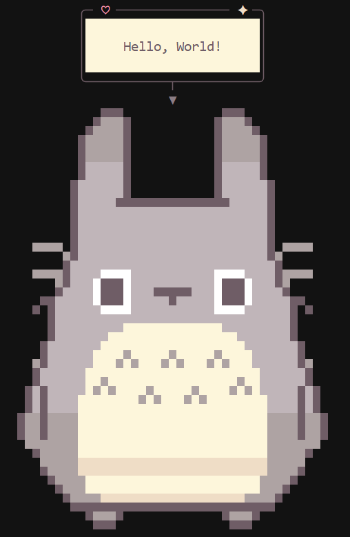

# totorosay


Inspired by cowsay, but the character for this is Totoro. Make Totoro say anything in your CLI


## Install
Without needing to install:
```bash
npx totorosay "Hello, World!"
```

Or

```bash
npm i totorosay
totorosay "Hello, World!"
```


## Usage
```ts
// app.js
import {totorosay} from 'totorosay';

console.log(totorosay('Hello, World!'))
// and then run with: node app.js
```


## License
MIT